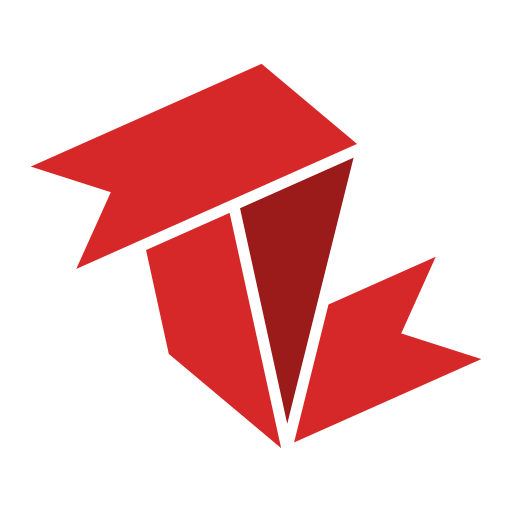

### Hello, it's Steven. I code and build things.

#### Co-founder of Dewble → [**getredribbon.com**](https://getredribbon.com)

#### It's official → [**Printect.net**](https://www.printect.net/)

Everything I build, categorized, organized, and live, lives at [**www.naliwajka.com**](https://www.naliwajka.com)

---

## Red Ribbon

**PDF markup and measurement for architecture, engineering and construction.** 
Fast on huge drawing sets, on Windows, macOS and Linux, and right in the browser with [Red Ribbon Lite](https://getredribbon.com/lite/).

<table>
<tr>
<td width="33%" align="center" valign="top"><b>Markup</b> Clouds, callouts, stamps and more, saved as real PDF annotations</td>
<td width="33%" align="center" valign="top"><b>Measurement</b> Calibrate, measure with snapping, and total the quantities</td>
<td width="33%" align="center" valign="top"><b>Review together</b> Live sessions with your team, and compare between revisions</td>
</tr>
<tr>
<td width="33%" align="center" valign="top"><b>Every page job</b> Combine, split, redact, OCR, forms and signatures</td>
<td width="33%" align="center" valign="top"><b>Sets and search</b> A sheet set as one document; search every file at once</td>
<td width="33%" align="center" valign="top"><b>Your workflow</b> Shortcuts, a command palette, Revit and scripting</td>
</tr>
</table>

**1,000,000+** lines of Rust &nbsp;·&nbsp; **13,000+** automated tests &nbsp;·&nbsp; CI on Linux, Windows and macOS

Try it free for 14 days → [**getredribbon.com**](https://getredribbon.com)

---

## Across the board

Nine fields, 30+ languages, one person.

<table>
<tr>
<td width="33%" valign="top"><b>Desktop apps</b> Red Ribbon, a PDF editor in Rust for Windows, macOS, Linux and the browser, plus my own desktop launcher and control panel. <code>Rust</code> <code>C#</code> <code>NSIS</code> <code>WiX</code></td>
<td width="33%" valign="top"><b>Revit and AutoCAD</b> At Salas O'Brien: a Revit API add-in that builds COMcheck energy-code forms straight from the model, and the C# tools around it. <code>C#</code> <code>Revit API</code> <code>WinForms</code> <code>PowerShell</code></td>
<td width="33%" valign="top"><b>Commerce</b> Printect, built solo: catalog, a quoting engine that slices and prices an upload, build-plate packing, labels and payments. <code>Go</code> <code>Python</code> <code>Stripe</code> <code>EasyPost</code></td>
</tr>
<tr>
<td width="33%" valign="top"><b>Infrastructure</b> A Proxmox cluster of self-written services on VLAN-segmented MikroTik networking, WireGuard and an nginx edge. <code>Proxmox</code> <code>OpenTofu</code> <code>RouterOS</code> <code>WireGuard</code></td>
<td width="33%" valign="top"><b>CI/CD and releases</b> GitLab runners on Linux, Windows and macOS, test suites split across machines, signed builds and a manual production gate. <code>GitLab CI</code> <code>Docker</code> <code>Bash</code> <code>Azure Signing</code></td>
<td width="33%" valign="top"><b>Web and identity</b> The naliwajka.com tools (blog, paste, drop, library, status) behind a self-hosted sign-in shared by every site. <code>Python</code> <code>FastAPI</code> <code>JavaScript</code> <code>OIDC</code></td>
</tr>
<tr>
<td width="33%" valign="top"><b>Games and mods</b> Garry's Mod BMX: the bike and park map on the Workshop, plus their gamemode. A Minecraft plugin with datapacks and proximity voice. A Factorio tool in Rust. <code>Lua</code> <code>Java</code> <code>MCFunction</code> <code>Rust</code></td>
<td width="33%" valign="top"><b>Hardware and 3D printing</b> PCBs in KiCad, Arduino firmware, parametric STLs generated from code and a slicer running headless on a server. <code>KiCad</code> <code>Arduino</code> <code>SOLIDWORKS</code> <code>Python</code></td>
<td width="33%" valign="top"><b>Teaching</b> Taught C#, Java, Python and SQL at Kennesaw State, where I earned my MS in Electrical and Computer Engineering. <code>C#</code> <code>Java</code> <code>Python</code> <code>SQL</code></td>
</tr>
</table>

---

### What I code with:

Every language I write, counted from the repos on my rack's GitLab. My work at Salas O'Brien is included as totals only, since those repositories are private.

---

## My Work

Real line counts, served live from my home lab (not a third-party counter):

 &nbsp; 

 &nbsp; 

 &nbsp; 

---

## Lately on GitHub

| Project | What it is | |
| :--- | :--- | :---: |
| [**BMX**](https://github.com/StevenNaliwajka/gmod-bmx) | A lean-steered BMX bike for Garry's Mod, [on the Workshop](https://steamcommunity.com/sharedfiles/filedetails/?id=3814420080) | Lua |
| [**BMX (Mode)**](https://github.com/StevenNaliwajka/gmod-bmx-mode) | The gamemode the BMX server plays | Lua |
| [**Petopia BMX Fall**](https://github.com/StevenNaliwajka/petopia_bmx_fall) | The BMX park map, [on the Workshop](https://steamcommunity.com/sharedfiles/filedetails/?id=3815469993) | Lua |
| [**Burrito Radio**](https://github.com/StevenNaliwajka/burrito-radio) | A Garry's Mod radio that plays YouTube, fading with distance | Lua |
| [**Burrito Grinch**](https://github.com/StevenNaliwajka/gmod-grinch) | The dancing Grinch as a Garry's Mod player model | Python |
| [**factorio-window-memory**](https://github.com/StevenNaliwajka/factorio-window-memory) | Factorio's windows open where you last dragged them | Rust |
| [**crealityprint-headless**](https://github.com/StevenNaliwajka/crealityprint-headless) | The slicer behind Printect's quotes, running on a server with no display | Python |
| [**HL-EdgeGate**](https://github.com/StevenNaliwajka/HL-EdgeGate) | The nginx + certbot edge in front of the rack | Python |

---

## Peter Portal

Roll your own → [**www.naliwajka.com/peter**](https://www.naliwajka.com/peter)

